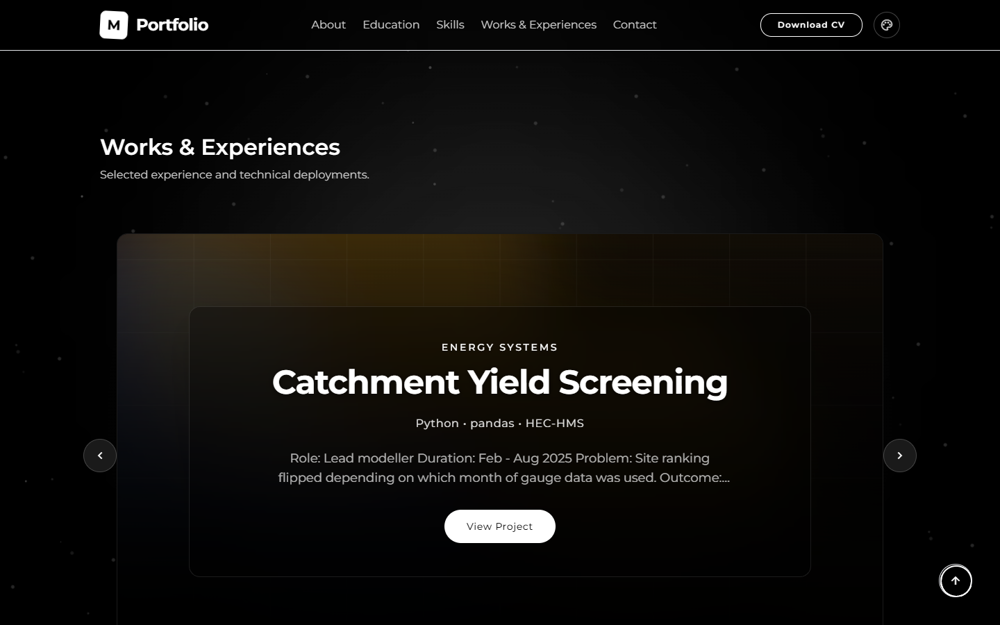
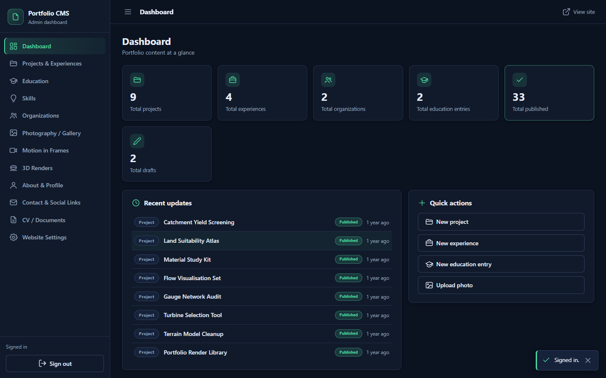
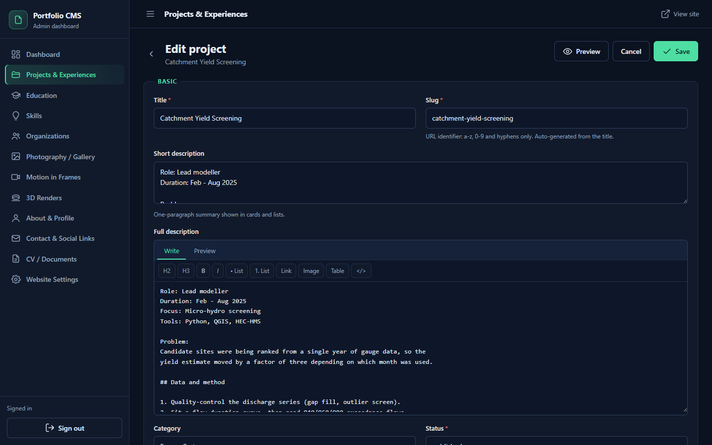
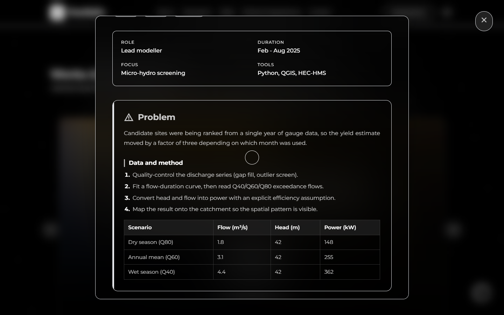
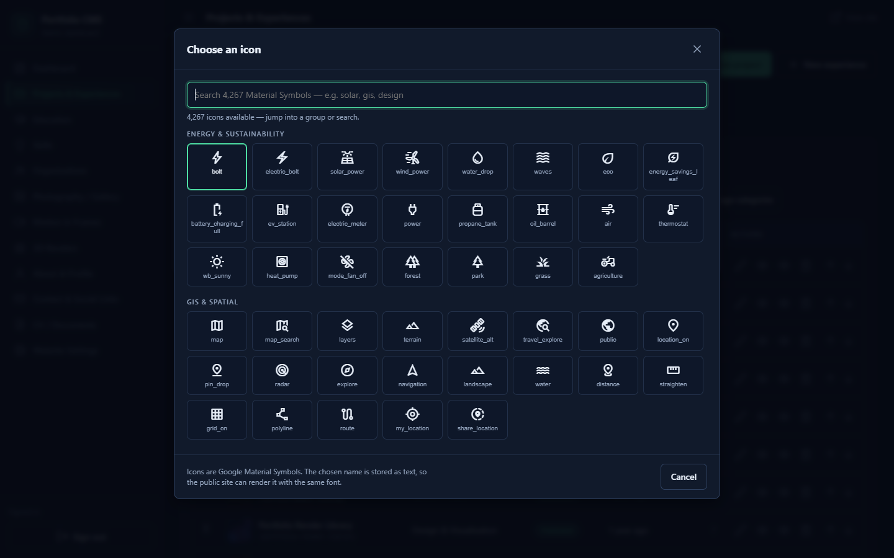
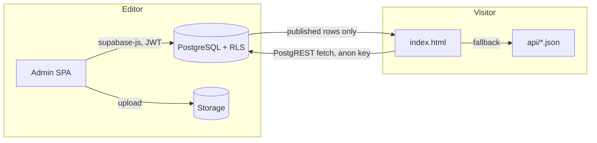

# Supabase CMS for a static site

A working, production-tested CMS bolted onto a plain HTML/Vite site: Supabase
(Auth + PostgreSQL + Storage) for the data, a private admin dashboard for editing,
and Cloudflare Pages for delivery. The public page keeps its original design. It
just stops being hardcoded.

This repository is the backend half of a real portfolio site, extracted and cleaned:
the schema, the RLS policies, the admin SPA, the migration and verification scripts,
the demo harness, and the documentation that explains why each decision was made.



---

## What is in here

| Path | What it is |
|---|---|
| `supabase/migrations/` | 9 idempotent migrations: schema, RLS, hardening, upload fix, section settings, two media galleries, media rotation |
| `supabase/setup-all.sql` | The same migrations concatenated, ready to paste into the Supabase SQL editor |
| `admin/` | The admin SPA: plain ES modules, no framework, schema-driven CRUD |
| `src/cms/shape.js` | One pure mapper that turns database rows into the legacy content shape the page already understood |
| `src/cms/public-content.ts` | The public loader: PostgREST over plain `fetch`, no supabase-js in the page bundle |
| `scripts/` | Migration with a byte-for-byte fidelity gate, admin bootstrap, live verification, icon library build, repair tools |
| `tests/shape.test.mjs`, `demo/shape.test.mjs` | Mapper tests that run with `node --test` and need no database |
| `demo/` | A dependency-free Supabase mock plus a fictional dataset, so screenshots and demos run with zero credentials |
| `docs/` | Architecture, schema reference, security model, admin guide, migration, deploy, verification, troubleshooting |

## Screenshots

Every screenshot in `docs/images/` was captured from the demo dataset in `demo/`.
The content is fictional: invented projects, a placeholder portrait, `example.com`
addresses. No personal data from the production site appears anywhere in this
repository.

| Public site | Admin dashboard |
|---|---|
|  |  |
|  |  |
|  |  |

Full tour with captions: [docs/09-screenshots.md](docs/09-screenshots.md).

## How it works in one screen



1. Content lives in 16 tables. Drafts are invisible to anonymous visitors because a
   row level security policy says so, not because the front-end filters them.
2. The public page fetches published rows, maps them into the shape the renderer
   already used, and paints the same DOM as before.
3. If the database is unreachable, the page falls back to `api/*.json` and still
   renders.
4. Writers sign in at `/admin/`, edit through generated forms, upload media, and
   publish. There is one role and it is allow-listed, so no second account exists
   unless an admin creates one with the service role.

Deep dive: [docs/01-architecture.md](docs/01-architecture.md).

## Quick start

```bash
# 1. Database
#    Create a Supabase project, open the SQL editor, paste supabase/setup-all.sql, run it.

# 2. Environment
cp .env.example .env          # fill in project URL, anon key, service role key

# 3. First admin (creates the auth user and the allow-list row)
ADMIN_PASSWORD='a-strong-password' node scripts/bootstrap-admin.mjs you@example.com

# 4. Verify the whole chain against the live project
node scripts/verify-cms.mjs

# 5. Build and deploy
npm run build
npx wrangler pages deploy dist --project-name <project> --branch=main
```

The order matters. Step 3 needs the service role key, which is why it is a local
script and never a browser feature.

## Try it without a Supabase account

`demo/serve.mjs` implements enough of the PostgREST, GoTrue and Storage HTTP surface
for the public page and the admin dashboard to run against fictional data. No keys,
no network, no account.

```bash
npm run build                                     # a normal build of the site
node demo/serve.mjs --site dist                   # mock API on http://localhost:8787
# admin: http://localhost:8787/admin/  (admin@example.com / demo-password)
```

This is the harness that produced every screenshot here, and the reason the docs can
show a fully populated dashboard without exposing a real person's data. Details:
[docs/10-demo-harness.md](docs/10-demo-harness.md).

## Use it with an AI coding agent

`SKILL.md` is written to be loaded directly as project instructions for an agent
(Claude Code, Cursor, Codex, Copilot, or anything that accepts markdown context):

> Read SKILL.md and follow it to add this CMS to my site.

The playbook is tool-agnostic. Every step is plain SQL, Node or a CLI command that a
human can run too.

## Design decisions worth knowing

- **The renderer was not rewritten.** A pure mapper (`src/cms/shape.js`) produces the
  exact legacy shape, so the public page stayed visually identical while the data
  source changed underneath it.
- **RLS is the security boundary.** Anonymous visitors get `select` on published rows
  only, and `admin_users` has no insert policy at all. Application code is a
  convenience, not the enforcement.
- **Migration is guarded by a fidelity check.** The importer refuses to write unless
  the mapped output is byte-identical to the source content for every section.
- **Writes degrade instead of blocking.** If a column is missing because a migration
  has not run yet, the admin drops that one column, saves the rest, and logs a
  warning rather than throwing the edit away.
- **Child rows are diffed, never wiped.** Gallery media is synced with an explicit
  insert, update and delete plan, because a delete-then-insert once erased a gallery.

## Repository scope

This repo is the backend of a live portfolio CMS. The front-end half (rendering,
galleries, animation, theming) lives in
[portfolio-frontend-skill](https://github.com/fachrur1/portfolio-frontend-skill). Site-specific strings
(domain, CV filename, seeded email, account names) have been replaced with
placeholders so the code runs as a reference rather than a copy of someone's
identity.

## Requirements

Node 20 or newer, a Supabase project (the free tier is enough), and a Cloudflare
Pages project if you want the same hosting setup. The admin app needs no build step:
it is plain ES modules served as static files.

## License

MIT.