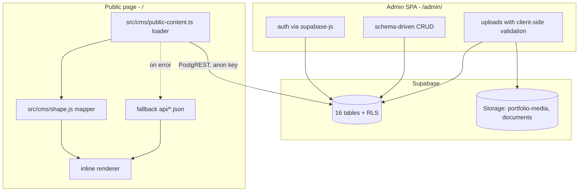
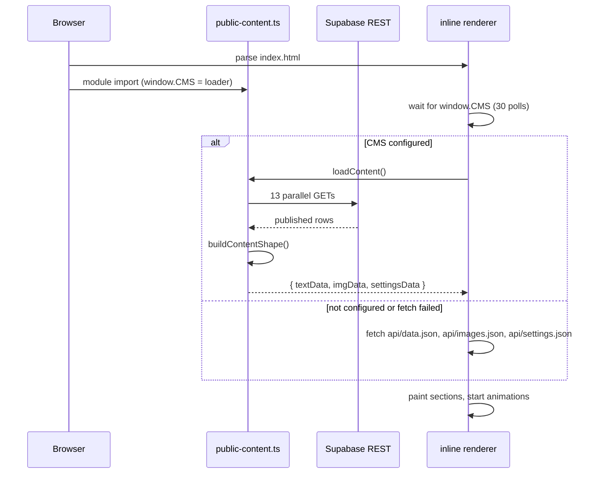

# Architecture

The site is one HTML file that used to hold its content inline. The CMS keeps that
file and moves the content behind a database. Nothing about the page's rendering
model changes; only where the data comes from.

## The three layers



### 1. Database

Content and permissions live together. Row level security decides what an anonymous
visitor can read, so a bug in the front-end cannot leak a draft. Two storage buckets
(`portfolio-media`, `documents`) are public-read, admin-write.

The schema is documented in [02-database-schema.md](02-database-schema.md) and the
policy set in [03-security-model.md](03-security-model.md).

### 2. Mapper

`src/cms/shape.js` is the seam between the database and the page.

```js
buildContentShape({ profiles, projects, projectMedia, experiences, education,
                    skills, organizations, gallery, categories, settings,
                    socialLinks, documents, siteImages })
  // -> { textData, imgData, settingsData }
```

`textData` is the object the renderer already consumed: `hero`, `about`, `contact`,
`education`, `skills`, `organizations`, `photography`, `works`, plus section copy.
`imgData` is a flat `{ slot: url }` map; the mapper invents slots for rows that have
no named one (`wm3` for the fourth work's cover, `wg3_1` for its second gallery
image), so URLs stay stable across renders.

Why a pure mapper instead of typed queries in the page:

- The same code powers the browser, the migration script and the unit tests. One
  definition of "what the page expects".
- It can run offline over exported rows, which is what makes the byte-for-byte
  migration check possible.
- It has no dependencies, so `node --test` can import it directly.

### 3. Renderer

The whole public page is `index.html`: markup, an inline `<style>`, a Tailwind CDN
config, and one inline module that paints each section by element id
(`#cms-hero-title`, `#cms-works-container`, and so on).

The renderer treats every CMS string as untrusted. `esc()` for text interpolation,
an allowlist sanitiser for markdown output, and a scheme check on `href`/`src`.

## Boot sequence



Two things make this robust:

- The loader waits for the module rather than assuming it exists, so a blocked or
  failed module still leaves a working page.
- The fallback files have the same shape as the mapper output. The renderer cannot
  tell the difference, which is why the site worked before the database existed and
  continues to work when the database is unreachable.

## Build pipeline

```bash
npm run build
# 1. tsx scripts/build-cms.ts   -> writes public/api/*.json from content/
# 2. vite build                 -> dist/ (page, admin, extra entries)
```

- `build-cms.ts` is the prebuild. It prefers a monolithic `content/data.json` when
  present and otherwise assembles the modular markdown files. Either way the output
  is `public/api/`, which Vite copies into `dist/`.
- `VITE_SUPABASE_URL` and `VITE_SUPABASE_ANON_KEY` are inlined at build time. A
  build produced on a machine with `.env` is deployable as-is; there is no runtime
  configuration.
- The build has four entry points: the public page, the admin SPA, and two extra
  standalone tools that share the same deployment.

## File map

| Path | Responsibility |
|---|---|
| `admin/index.html` | Admin shell, loads `./src/main.js` |
| `admin/src/main.js` | Router, auth gate, admin gate, nav |
| `admin/src/schemas.js` | Module definitions: list columns and form fields |
| `admin/src/crud.js` | The CRUD engine: list, filters, paging, ordering, form |
| `admin/src/components.js` | Field controls: markdown, gallery, links, icon picker |
| `admin/src/api.js` | All Supabase calls, including the missing-column fallback |
| `admin/src/payload.js` | Form state to row payload (tags, links, jsonb shaping) |
| `admin/src/drafts.js` | Unsaved-form snapshots, storage-injected and testable |
| `admin/src/media-sync.js` | Child-row diff plan for galleries |
| `admin/src/uploads.js` | Storage uploads with MIME and size validation |
| `src/cms/public-content.ts` | Public loader, plus CV link rewriting |
| `src/cms/shape.js` | Pure mapper, the contract between DB and page |
| `scripts/` | Migrate, bootstrap, verify, repair, build the icon library |
| `supabase/migrations/` | Schema and policies, one concern per file |
| `demo/` | Local Supabase mock + fictional dataset + capture harness |

## Constraints worth remembering

- **One HTML file, edited by string replacement.** There is no component tree to
  refactor. A broken quote in the inline script breaks the page silently, so a build
  plus a browser check is mandatory after touching it.
- **Tailwind comes from a CDN in the public page.** Plugins cannot be registered
  there, so `prose` classes do nothing. Markdown is styled by a hand-written
  `.md-body` stylesheet inside the page. (The front-end repository covers this in
  detail.)
- **The admin is a separate app with its own CSS.** It shares the database, not the
  styles, and it is `noindex`.
- **Everything the admin writes is untrusted at render time.** Nothing in the database
  is trusted to be safe HTML, including markdown that came from an editor.