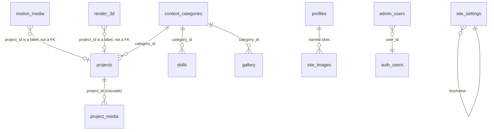

# Database schema

PostgreSQL 15 on Supabase. Sixteen tables: fifteen hold content, one
(`admin_users`) holds the allow-list. Everything here comes from
`supabase/migrations/`, which is the only source of truth.

## Conventions

Every content table follows the same pattern, which is what lets one admin engine
drive all of them.

| Column pattern | Purpose |
|---|---|
| `id uuid default gen_random_uuid()` | Stable identity, also the drag-order handle |
| `status text check (status in ('draft','published'))` | Publication state, default `draft` |
| `created_at`, `updated_at` | `updated_at` maintained by the `set_updated_at()` trigger |
| `sort_order` or `display_order` | Manual ordering; lower comes first |
| `slug text unique` | Human-readable key where a row needs one |
| `jsonb` arrays | `text[]` for tags and skill lists, `[{url, caption, alt}]` for media, `[{label, url}]` for links |

Two exceptions worth knowing:

- `documents` uses `is_active` instead of `status`. Exactly one active row per
  `doc_type` is enforced by a partial unique index, and the public page points every
  "Download CV" anchor at that row.
- `motion_media` and `render_3d` add `is_published boolean generated always as
  (status = 'published') stored`. The admin list filters on `status`; the public
  gallery queries can filter on a boolean without recomputing anything.

## Entity overview

`motion_media.project_id` and `render_3d.project_id` are `text`, deliberately. They
carry a display label that the gallery prints as an overline. Putting a UUID there
renders a raw UUID on the card.

## Tables

### Reference and identity

| Table | Rows of | Notes |
|---|---|---|
| `admin_users` | Allow-listed editors | `user_id` references `auth.users`, `role` in (`admin`, `editor`). No insert policy: the service role creates rows |
| `content_categories` | Project categories, skill groups, gallery categories | `kind` in (`project`, `skill_group`, `gallery`, `experience`, `organization`), unique on `(kind, slug)`, optional Material Symbols `icon` |
| `site_settings` | Key/value site copy | `value` is `jsonb`, plus a human `label` for the editor. Public read is restricted to an explicit key allowlist |
| `site_images` | Named image slots | `key` is the primary key (`profile_image`, `about_image`, ...). Feeds `imgData` directly |
| `social_links` | Contact and social entries | `platform` (`email`, `linkedin`, `github`, `instagram`, `website`, `other`), `visible` flag |

### Content

| Table | Purpose | Notable columns |
|---|---|---|
| `profiles` | Hero and about copy | `hero_line1/2`, `professional_headline`, `short_intro` (typed line), `about_body` (markdown), `profile_photo_url`, `is_primary` (partial unique index) |
| `projects` | Case studies | `full_description` (markdown), `role`, `team`, `technologies`/`tools`/`technical_skills` (jsonb arrays), `featured`, `include_in_works`, `display_priority`, `related_resources` |
| `project_media` | Ordered gallery per project | `project_id` (cascade), `url`, `caption`, `alt`, `sort_order` |
| `experiences` | Work, research, freelance | `organization_name`, `position`, `employment_type`, `currently_working`, `media` (jsonb gallery), `include_in_works` (default false) |
| `education` | Degrees | `institution`, `degree`, `field_of_study`, `relevant_coursework`, `display_order` |
| `skills` | One row per skill | `category_id` points at a `skill_group`, `show_proficiency` keeps percentages hidden unless enabled |
| `organizations` | Student bodies, communities | `organization_name`, `position`, `organization_type` |
| `gallery` | Photography grid | `title`, `image_url`, `category_id`, `capture_date`, `featured` |
| `documents` | CV and portfolio files | `file_url`, `storage_path`, `version`, `is_active` (partial unique per `doc_type`) |
| `motion_media` | Video gallery | `media_type` (`final_render`, `behind_the_scenes`, `combined`), `video_provider` (`upload`, `youtube`, `vimeo`, `gdrive`, `cloudflare_stream`, `bunny`, `other`), `poster_url`, `aspect_ratio`, `duration`, `rotation` |
| `render_3d` | 3D stills gallery | `image_url`, `thumb_url`, `kind`, `aspect_ratio`, `rotation` |

## Ordering

The public page sorts by a single column per table, and the mapper falls back from
`sort_order` to `display_order`. Keep that in mind when adding a table: pick the one
the mapper already reads, or teach it the new name.

`works` (the public carousel) is a merge of `projects` and `experiences` filtered by
`include_in_works`, then sorted by `sort_order`, then `display_priority` descending,
then `created_at`. Two tables, one list, one renderer.

## Migrations

| File | What it does |
|---|---|
| `0001_schema.sql` | Tables, triggers, indexes, ordering columns, settings seeds |
| `0002_rls.sql` | Grants, RLS policies for every table, storage buckets and policies |
| `0003_hardening.sql` | Revokes TRUNCATE/REFERENCES, restricts `site_settings` read to a key allowlist, hardens `is_admin()` |
| `0004_upload_fix.sql` | Replaces metadata-based storage checks with admin-only bucket policies |
| `0005_photography_section_settings.sql` | Photography heading and description keys |
| `0006_motion_gallery.sql` | `motion_media` table, policies, section copy, allowlist update |
| `0007_motion_media_combined_type.sql` | Allows `media_type = 'combined'` |
| `0008_render_3d.sql` | `render_3d` table, policies, section copy |
| `0009_media_rotation.sql` | `rotation` (0/90/180/270) on both galleries, with check constraints |

`supabase/setup-all.sql` is the concatenation of all nine, in order, for a first-time
paste. Both paths are safe to re-run: every statement is guarded.

## Where the schema and the UI disagree

Two spots are intentional but surprising, so they are worth stating once:

- `render_3d.kind` still allows `'turntable'` because the column predates a design
  change. The section is now a gallery of stills, and the admin exposes the same
  field as a category label.
- `profiles.is_primary` is enforced by a partial unique index, not by a constraint on
  the column. Creating a second primary profile fails with a duplicate key error on
  the index, not on a named constraint.