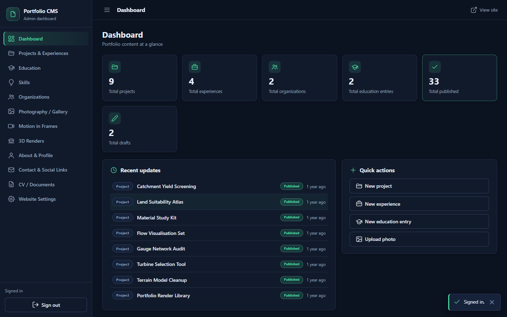
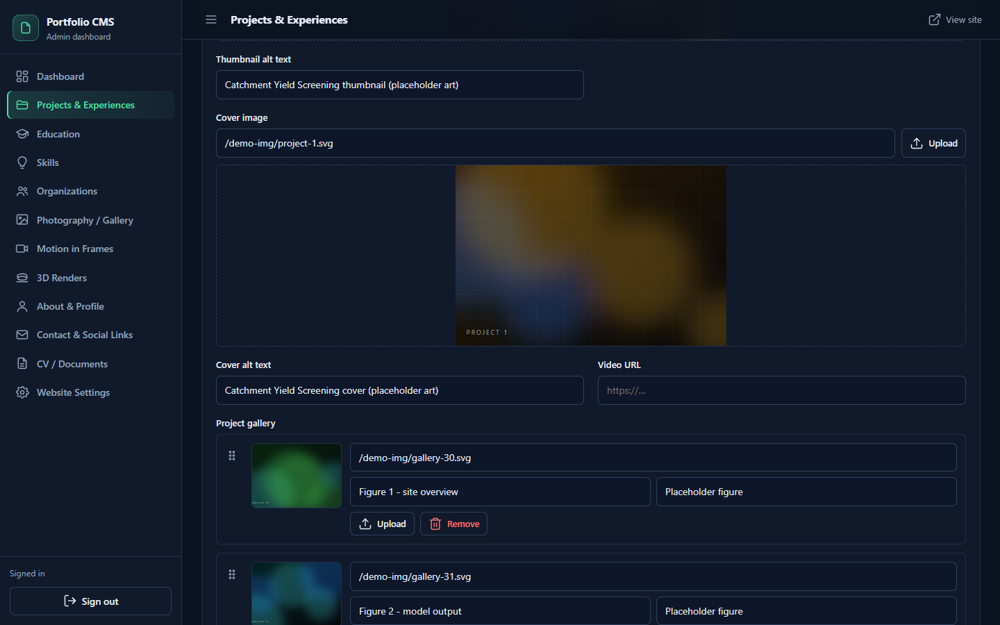
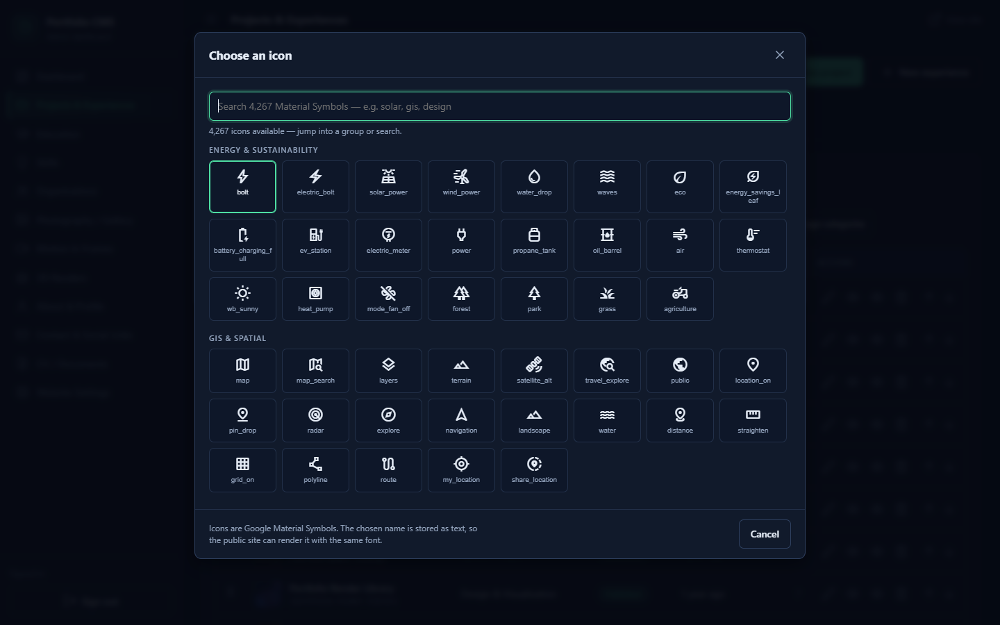

# Admin dashboard

A private single-page app at `/admin/`. Plain ES modules, no framework, no build
step of its own: Vite bundles it as one of the site's entry points and Cloudflare
Pages serves it as static files. It is `noindex, nofollow` and it holds no secrets.

## Routing

Hash routing, so the whole app is one HTML response.

| Route | Screen |
|---|---|
| `#/dashboard` | Counts, recent updates, quick actions |
| `#/work` | Projects and experiences, two tabs over one engine |
| `#/projects/edit/<id>` | Project editor |
| `#/education`, `#/skills`, `#/organizations` | List and editor for those tables |
| `#/gallery` | Photography grid, card layout |
| `#/motion`, `#/render3d` | The two media galleries |
| `#/profile` | Singleton: hero, about, portrait |
| `#/contact` | Social links plus contact copy |
| `#/documents` | CV management, one active document per type |
| `#/settings` | Every `site_settings` key, plus the category manager |

## The two gates

Every route except `#/login` passes through both, in this order:

1. **Session check.** `getSession()` against `supabase-js`. No session means the
   login screen.
2. **Admin check.** `select role from admin_users where user_id = <jwt sub>`. No row
   means the "not authorized" screen, not an empty dashboard.

The admin check is cached for five minutes, then re-run. Removing someone from
`admin_users` therefore locks them out of the UI quickly, independently of JWT
lifetime.

## One engine, twelve modules

`admin/src/schemas.js` declares what each module looks like, and
`admin/src/crud.js` turns that declaration into a working screen. Adding a module is
one entry in `modules` plus one row in `NAV_ITEMS`.

A module declaration covers:

- **List columns**: key, label, sortable, renderer hint (`title-image`, `category`,
  `status`, `updated`, `number`).
- **Form fields**: name, label, type, section, `required`, `nullable`, help text,
  placeholder.
- **Behaviour flags**: which field holds the ordering value, which fields the search
  box should use, which category kind feeds a select.

The list screen gives you, for free: debounced search over the declared fields,
status and category filters, sortable headers, ten rows per page, drag-to-reorder
inside the current ordering, per-row edit, duplicate-safe delete with confirmation,
and a preview modal that renders the row the way the public page would.

## Field types

| Type | Control | Notes |
|---|---|---|
| `text` | Input, with slug generation for slug fields | |
| `textarea` | Fixed-rows textarea | |
| `markdown` | Editor with Write and Preview tabs plus a small toolbar | Preview runs the same markdown pipeline as the public page |
| `tags` | Chip input, Enter to add | Serialised as a flat `string[]` |
| `links` | Repeatable `{label, url}` rows | Add, remove, reorder |
| `image` | Upload or paste URL, with preview and clear | Validates type and size before upload |
| `video` | Upload or remote provider URL | Provider inferred from the URL |
| `gallery` | Ordered media list with captions and alt text | Child rows, diffed on save |
| `icon` | Text input plus a live glyph and a browse dialog | Material Symbols, 4,267 names |
| `select` | Options from a literal list or from `content_categories` | `optionsFromCategories: 'project'` |
| `date` | Native date input | |
| `number` | Numeric input, honours `nullable` | |
| `checkbox` | Toggle | |

Two rules that prevent silent data loss:

- A `select` bound to a column with a `CHECK` constraint must be `required: true`.
  Otherwise the empty option saves `''` and violates the constraint.
- A nullable numeric column must declare `nullable: true`, or the payload builder
  coerces the empty input to `0` and quietly changes the data.

## Editing behaviour

**Unsaved work survives navigation.** The router re-renders `#content` on every hash
change, which used to throw away a half-filled form. `admin/src/drafts.js` snapshots
the active form before the route changes, keyed by table and row id, with a 12 hour
TTL. Reopening the row offers to restore it. Uploaded media inside the gallery
control is part of the snapshot.

**Markdown is previewed, not trusted.** The preview pane renders through the same
sanitiser path the public page uses. Anything an editor can paste is treated as
untrusted HTML, because the editor is a browser session with a valid JWT.

**Galleries are diffed, never replaced.** `admin/src/media-sync.js#planMediaSync`
matches incoming rows to existing ones by id, falls back to URL matching, and
produces inserts, updates and deletes in that order. Passing `null` means "leave the
children alone", which is how a project edit that never touched media avoids
churning it.

**Categories are edited in place.** The category manager sits behind "Manage
categories" on any list that has a category select. Rows edit name, slug and icon
inline, with the icon picker attached.

The picker is generated, not typed by hand: `scripts/build-icon-library.mjs` fetches
the official Material Symbols metadata, keeps 4,267 unique names, groups the useful
ones by theme, and writes `admin/src/icon-library.js`. Unknown names are allowed
(paste anything) but flagged, because a typo renders nothing on the public site.

## Uploads

| Bucket | Content | Limit | Path |
|---|---|---|---|
| `portfolio-media` | Images | 10 MB | `media/<epoch>-<safe-name>` |
| `portfolio-media` | Video | 50 MB | `media/videos/<epoch>-<safe-name>` |
| `documents` | PDF | 20 MB | `documents/<epoch>-<safe-name>` |

The epoch prefix keeps uploads from colliding and, usefully, groups them in time,
which is what `scripts/recover-orphan-media.mjs` uses to re-attach files that were
orphaned before a bug fix.

## Document management

`documents` has one active row per `doc_type`, enforced by a partial unique index.
Activating a new CV deactivates the previous one in the same operation, and the
public page's "Download CV" anchors are rewritten at load time from the active row.
That means changing the CV never requires editing the page.

## Settings

`#/settings` lists every row of `site_settings` with its `label`, and saves through
the form engine. Only the keys listed in the public read policy are visible to the
public site (see [03-security-model.md](03-security-model.md)); adding a new key means
recreating that policy.

## What the admin deliberately does not do

- No registration, no user management UI. Admins are created with the service role.
- No scheduled publishing, no review workflow. One role, one state.
- No rich HTML editing. Markdown is the contract between the editor and the renderer.
- No image cropping or resizing. Uploads are stored as they arrive; the public page
  handles framing with CSS.