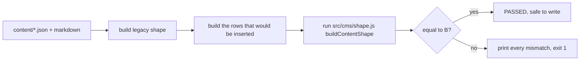

# Content migration

Moving years of hardcoded content into a database is the step where a CMS project
usually loses its design. The rule here is simple: the migration is correct only if
the rendered output does not change.

## The two failure modes this script prevents

**Rendering drift.** If the importer rewrites a description, drops a line, or fills a
metadata field the author never wrote, the page changes subtly and nobody notices for
a month. The guard is an offline fidelity check that runs before any write.

**Partial imports.** A failure halfway through leaves half the tables populated. Re-
running then skips everything that already has rows, which sounds safe until you
realise the table that failed is skipped too, because it is not empty either. The gate
is per table, on that table's own emptiness.

## Usage

```bash
# 1. Dry run. Reads the source content, runs the fidelity check, writes nothing.
node scripts/migrate-to-supabase.mjs

# 2. Import, only after the check passes.
node scripts/migrate-to-supabase.mjs --confirm
```

Environment: `VITE_SUPABASE_URL`, `SUPABASE_SERVICE_ROLE_KEY`, and `SITE_URL` (used to
resolve relative image paths into absolute storage URLs).

## What the fidelity check does



Both sides are produced by the same functions the site uses at runtime, so a pass
means "the page renders identically", not "the strings look similar".

The check compares, section by section: hero, about, contact, education, skills,
organizations, photography, and every work entry including its tags, gallery ids and
description.

## Verbatim rules

- **Descriptions are stored exactly as written.** No trimming, no re-wrapping, no
  normalising whitespace. A line break can be a layout decision.
- **Structured columns only fill gaps.** `role`, `team`, dates, `location`, `tools`
  and `technical_skills` are populated from the source, but the mapper only injects
  them when the description does not already carry the matching `Role:` style meta
  line. An author who wrote their own metadata keeps their wording.
- **Order is preserved.** `sort_order` is assigned from array position, so the first
  card stays first.
- **Image URLs are made absolute** against `SITE_URL` before insertion, because the
  public page resolves them without a base.

## Idempotency

`insertIfEmpty(table, rows, uniqueColumn)` skips a table that already has rows, and
`insertMissing(table, rows, uniqueColumn)` adds only the rows the table does not have
yet. Which one runs depends on whether the table is a top-level content table or a
child table that may legitimately be partially populated.

Practical consequence: if the import dies on table six, fix the cause, re-run, and
tables one to five are skipped while six onwards are attempted again.

## After the import

Three repair scripts exist because real content arrived with real damage.

| Script | Fixes |
|---|---|
| `scripts/clean-cms-descriptions.mjs` | Paste artefacts from Google Docs or Word (`List item…`, `Heading…` prefixes). Dry run by default, `--write` to apply, writes a backup first |
| `scripts/repair-tag-fields.mjs` | Tag columns that were stored as `[{url, caption, alt}]` instead of `["Blender"]`, which the page prints as `[object Object]`. Recovers from the markdown frontmatter when possible |
| `scripts/recover-orphan-media.mjs` | Files in storage that no row references, after a gallery was wiped by a delete-then-insert bug. Groups orphans by upload epoch and filename keywords, then re-attaches them |

Every one of them is dry-run by default and refuses to write without an explicit
flag. A repair script that runs on import is how data disappears.

## Migrating a different site

The script is written against one content shape: a `content/` directory with a
monolithic `data.json` or modular markdown with frontmatter. For another site, the
parts to keep are the shape of the process, not the parsing:

1. Build the legacy shape from the source of truth.
2. Build the rows you would insert.
3. Map the rows back with the real mapper.
4. Compare. Refuse to write on any difference.
5. Gate each table on its own emptiness.
6. Dry run by default.

The parsing functions (`parseYearRange`, `parseEduPeriod`, `slugify`, `resolveUrl`)
are the only site-specific code. Everything else is reusable as-is.